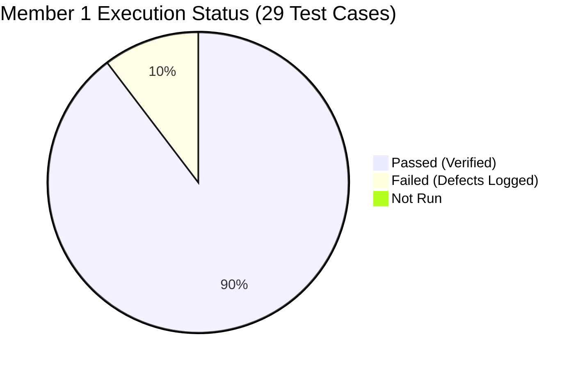

# 🧪 DEPI — CAI5_SWD6_S4 | Team 1 Testing Project
### Automated API Testing & Manual Quality Assurance for [Automation Exercise](https://automationexercise.com)

[](https://automationexercise.com)
[](https://github.com/Daniel-Lamie95/CAI5_SWD6_S4-DEPI5_Team1)
[](https://automationexercise.com/api_list)
[](https://www.postman.com/)
[](https://products.office.com/excel)

---

## 📌 Table of Contents
- [📖 Project Overview](#-project-overview)
- [📂 Repository Structure](#-repository-structure)
- [👥 Team Work Breakdown (6 Members)](#-team-work-breakdown-6-members)
- [🌟 Member 1 Spotlight — Products Catalog APIs](#-member-1-spotlight--products-catalog-apis)
  - [Tested Endpoints](#tested-endpoints)
  - [Live Execution Results & Metrics](#live-execution-results--metrics)
  - [Identified Defects & Quirks (Defect Log)](#identified-defects--quirks-defect-log)
- [🚀 How to Run the Postman Collection](#-how-to-run-the-postman-collection)
- [📊 Test Documentation & Artifacts](#-test-documentation--artifacts)
- [🤝 Collaboration & Git Workflow](#-collaboration--git-workflow)

---

## 📖 Project Overview

This repository contains the end-to-end **Manual and Automated API Testing deliverables** for the **Digital Egypt Pioneers Initiative (DEPI)** under code **CAI5_SWD6_S4 (Team 1)**.

The target system under test is the [Automation Exercise](https://automationexercise.com) e-commerce web platform, covering:
- **Products Catalog & Directory Management**
- **Search Capabilities & Boundary Validations**
- **User Authentication, Registration, and Profile Management**
- **Security Validations (SQL Injection, Payload Sanitization, HTTP Method Constraints)**

---

## 📂 Repository Structure

```text
CAI5_SWD6_S4-DEPI5_Team1/
│
├── 📁 Api Testing/
│   ├── 📊 AutomationExercise_API_Testing_Team_Breakdown_Updated.xlsx   # Master Team Tracker + Member 1 Detailed Execution Log
│   ├── 📊 AutomationExercise_API_Testing_Team_Breakdown.xlsx           # Original Team Baseline Tracker
│   ├── 📊 API_TestCases.xlsx                                           # Shared API Test Cases Sheet
│   ├── 📮 Member1_ProductsCatalog_Postman_Collection.json              # Postman Collection v2.1.0 (25 Automated Requests)
│   └── 📝 Member1_ProductsCatalog_Testing_Documentation.md             # Complete Technical Documentation for Member 1
│
├── 📁 Manual Testing/
│   ├── 📋 Tests Cases.xlsx                                            # Manual Functional Test Cases
│   └── 🐞 Bug Report.xlsx                                             # Manual Testing Bug Reports
│
├── 📄 Test plan.pdf                                                    # Master QA Test Plan Document
└── 📄 README.md                                                        # Project Documentation (This File)
```

---

## 👥 Team Work Breakdown (6 Members)

| Team Member | Assignee | Assigned Module | Scope & Endpoints | Status |
| :---: | :---: | :---: | :--- | :---: |
| **Member 1** | **Rehab Adel** | **Products Catalog** | `GET /api/productsList`<br>`POST /api/searchProduct`<br>+ Boundary, Security & Negative Tests | **✅ Completed (100%)** |
| **Member 2** | **Angelina** | **Brands Directory** | `GET /api/brandsList`<br>`PUT /api/brandsList` | ⏳ Pending |
| **Member 3** | **Gerges** | **Product Search** | `POST /api/searchProduct` (Keywords, SQL Injection) | ⏳ Pending |
| **Member 4** | **Daniel Adel** | **User Authentication** | `POST /api/verifyLogin`<br>`DELETE /api/verifyLogin` | 🔄 In Progress |
| **Member 5** | **Ziad Omar** | **Registration & Deletion** | `POST /api/createAccount`<br>`DELETE /api/deleteAccount` | 🔄 In Progress |
| **Member 6** | **Ahmed** | **Account Updates & Lookup**| `PUT /api/updateAccount`<br>`GET /api/getUserDetailByEmail` | ⏳ Pending |

---

## 🌟 Member 1 Spotlight — Products Catalog APIs

Member 1 was assigned full ownership of the **Products Catalog APIs**, executing all test scenarios against the live environment.

### Tested Endpoints:
1. **API 1 – Get All Products:** `GET /api/productsList`
2. **API 2 – Search Product:** `POST /api/searchProduct` (Form Parameter: `search_product`)

### Live Execution Results & Metrics:



* **Total Test Cases Executed:** **29 Cases (100% Live Execution)**
* **Passed Cases:** **26 Cases (89.7%)**
* **Failed Cases (Real Defects Caught):** **3 Cases (10.3%)**
* **Not Run Cases:** **0 Cases**
* **Automated Postman Requests:** **25 Requests**

### Identified Defects & Quirks (Defect Log):

| Defect ID | Severity | Endpoint | Summary & Root Cause | Impact |
| :---: | :---: | :--- | :--- | :--- |
| **`DEF-01`** | **Medium** | `GET /api/productsList` | **Incorrect Response Content-Type Header**<br>Server returns `Content-Type: text/html; charset=utf-8` despite body being valid JSON. | Strict REST clients may misinterpret the payload MIME type. |
| **`DEF-02`** | **Low** | Unsupported Methods | **HTTP 200 OK returned on Invalid HTTP Methods**<br>Sending `POST` to `/api/productsList` returns status `200` with `{"responseCode": 405}` in the body instead of `HTTP 405 Method Not Allowed`. | Violates HTTP standard status code semantics; hinders proxy caching. |
| **`DEF-03`** | **High** | `POST /api/searchProduct` | **Empty Search Query Leaks Entire Catalog**<br>Sending `search_product=''` returns `responseCode: 200` with all 34 products instead of `400 Bad Request` or empty array `[]`. | Boundary validation failure; dumps entire database on blank form submit. |
| **`DEF-04`** | **Low** | `POST /api/searchProduct` | **JSON Body Unsupported**<br>Endpoint strictly requires `form-data` and rejects raw JSON bodies with `responseCode: 400` ("parameter missing"). | Documentation quirk; payload must be sent as form-data. |

---

## 🚀 How to Run the Postman Collection

### Option A: Via Postman Desktop / Web GUI
1. Open **Postman**.
2. Click **Import** (Top Left) and select:  
   [`Api Testing/Member1_ProductsCatalog_Postman_Collection.json`](./Api%20Testing/Member1_ProductsCatalog_Postman_Collection.json)
3. The collection is configured with Collection Variable:
   * `baseUrl`: `https://automationexercise.com`
4. Click on the collection name and press **Run Collection**. All 25 requests will execute sequentially with automated `pm.test` assertions.

### Option B: Via Newman CLI
If Node.js and Newman are installed on your machine:
```bash
npm install -g newman
newman run "Api Testing/Member1_ProductsCatalog_Postman_Collection.json"
```

---

## 📊 Test Documentation & Artifacts

All deliverables follow professional QA reporting standards:
* **Master Excel Tracker:** [`AutomationExercise_API_Testing_Team_Breakdown_Updated.xlsx`](./Api%20Testing/AutomationExercise_API_Testing_Team_Breakdown_Updated.xlsx)
  * `Execution Summary`: Dashboard KPI cards, endpoint breakdowns, and defect logs.
  * `Team Work Breakdown`: Preserved 6-member team roles and updated Member 1 to Completed.
  * `Member 1 - Products Catalog`: 29 detailed test cases with all 16 required columns, auto-filters, freeze panes, and text wrapping.
  * `Test Case Tracker`: Team tracker sheet with dynamic Excel formulas.
* **Member 1 Technical Guide:** [`Member1_ProductsCatalog_Testing_Documentation.md`](./Api%20Testing/Member1_ProductsCatalog_Testing_Documentation.md)

---

## 🤝 Collaboration & Git Workflow

- **Base Branch:** `main`
- **Feature Branch:** `feature/member-1-products-catalog`
- **Commit Convention:** Conventional Commits (`feat:`, `style:`, `docs:`)
- **Review Strategy:** Pull Request peer-review before merging into `main`.

---
*Created with dedication for the Digital Egypt Pioneers Initiative (DEPI) — CAI5_SWD6_S4 Team 1.*
